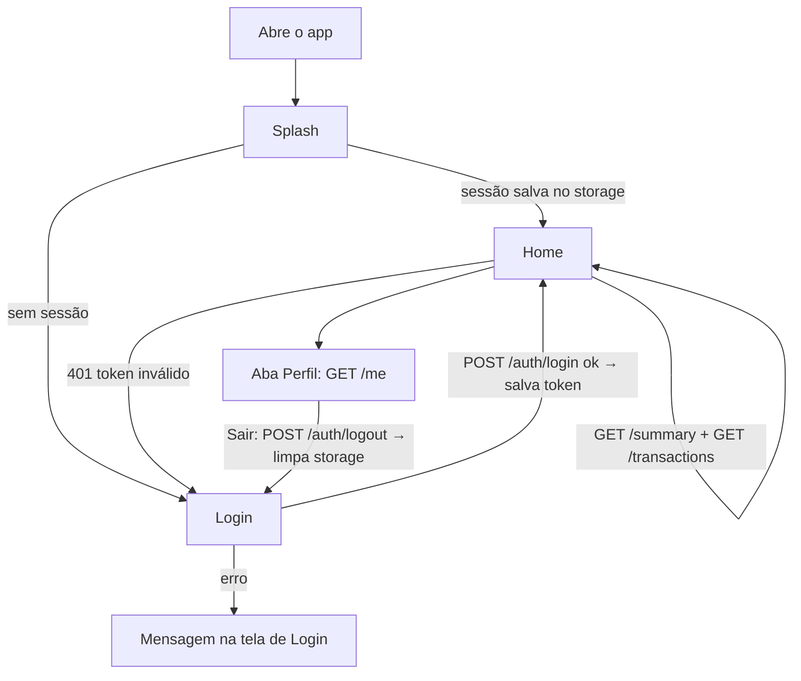

# Carteira Digital — Mobile II

App Flutter da disciplina Mobile II. Usa o design system do
[Finance Management](https://github.com/Emyrreis/financeManagement) e a API
simulada `carteira_server` (Dart + shelf).

## Como rodar

1. Suba o servidor (pasta `server` do pacote da aula):
   `dart pub get` e depois `dart run bin/server.dart` → `http://localhost:8080/health`
2. Na raiz deste projeto: `flutter pub get` e `flutter run` (emulador Android).
3. Login de teste: `ana@carteira.dev` / `123456`.

## Organização das pastas

```
lib/
├── main.dart                 # MaterialApp: tema, navigatorKey, abre a Splash
├── app/                      # O que é compartilhado pelas cenas
│   ├── app_dependencies.dart #   ApiClient + repositórios do Core (uma instância)
│   ├── shared_prefs_session_storage.dart # guarda a sessão no aparelho
│   ├── app_navigator.dart    #   navigatorKey usada pelos coordinators
│   └── theme_mode_button.dart#   alterna tema claro/escuro
└── scenes/                   # Uma pasta por cena, sempre com os mesmos 5 papéis
    ├── splash/   (tela invisível: decide Login ou Home)
    ├── login/
    ├── home/     (aba Lançamentos)
    └── profile/  (aba Perfil)
packages/
├── core/           # Modelos, Result, ApiClient e repositórios (contrato da API)
└── design_system/  # Tokens, tema e componentes (visual Finance Management)
```

## Padrão de cada cena (MVVM + Factory + Coordinator)

| Arquivo | Papel |
|---|---|
| `*_factory.dart` | Monta a cena: cria Server e Coordinator, injeta no ViewModel, entrega a View |
| `*_view.dart` | Só desenha, usando componentes do design system |
| `*_view_model.dart` | Estado e ações da tela; formata os dados para a View |
| `server_*.dart` | Interface (protocolo) + implementação real que usa o Core |
| `*_coordinator.dart` | Navegação para fora da cena |

```
factory.make()
  server      = Server()
  coordinator = Coordinator()
  viewModel   = ViewModel(server, coordinator)   // injeção de dependência
  view        = View(viewModel)
  → tela pronta para uso (visual + lógica)
```

## Fluxos



### Home (aba Lançamentos)

- **Chips de mês** → recarrega saldo (`/summary?month=`), categorias e lista.
- **Saldo do mês** → `BalanceCard`.
- **Por categoria** → `CategoryBar`, só despesas, % sobre o total de saídas.
- **Busca e filtro Todos/Receita/Despesa/Transf.** → `GET /transactions?q=&type=`.
- **Lista por dia** → `SectionHeader` + `TransactionTile`.
